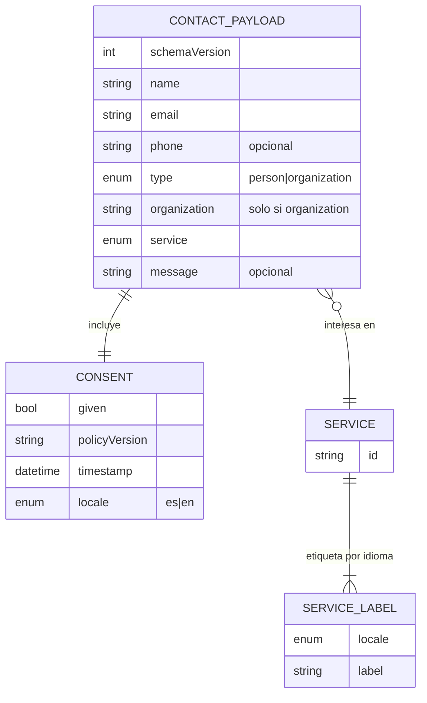

# Modelo de datos — confluye

**Sin base de datos ni almacenamiento propio** (RN-01, RNF-11). Los únicos datos personales son los del envío del formulario: existen en memoria del navegador hasta el envío y luego en el proveedor externo y la bandeja de email de Confluye (retención: hasta resolver la solicitud, máx. 12 meses; PRD §6). Fuente de verdad en código: `src/lib/form/schema.ts` (tipos, límites, enum) — esquema de payload versionado `schemaVersion: 1`.

## Payload del formulario (`ContactPayload` v1)
| Campo | Tipo | Obligatorio | Reglas (tras `trim`) | Input HTML | Sensibilidad |
|-------|------|-------------|----------------------|-----------|--------------|
| `schemaVersion` | `1` | Sí (automático) | constante | — | pública |
| `name` | string | Sí | 1–100 caracteres; solo espacios = vacío | `text`, `autocomplete="name"` | personal |
| `email` | string | Sí | ≤ 254; `local@dominio.tld` (regex pragmática, sin espacios) | `email`, `autocomplete="email"` | personal |
| `phone` | string | No | vacío o 7–15 dígitos; permitidos `+`, espacios, `-`, `()`; ≤ 20 caracteres (formato a confirmar, PRD RF-08) | `tel`, `autocomplete="tel"`, `inputmode="tel"` | personal |
| `type` | `'person' \| 'organization'` | Sí | enum | radio | interna |
| `organization` | string | Si `type=organization` | 1–120; **se omite** del payload si `type=person` | `text`, `autocomplete="organization"` | persona jurídica / posible personal |
| `service` | `ServiceId` | Sí | uno de los 9 ids | `select` | interna |
| `message` | string | No | ≤ 500 caracteres (contador; 501 bloquea); texto plano, nunca se renderiza como HTML | `textarea` + aviso de no incluir datos sensibles | riesgo de datos sensibles |
| `consent.given` | `true` | Sí | debe ser `true` (checkbox no premarcado) | checkbox | evidencia legal |
| `consent.policyVersion` | string | Sí (automático) | `version` del frontmatter de `privacy.md` del idioma activo (p. ej. `2026-10-27.1`) | — | evidencia legal |
| `consent.timestamp` | string ISO-8601 UTC | Sí (automático) | momento del envío | — | evidencia legal |
| `consent.locale` | `'es' \| 'en'` | Sí (automático) | idioma de la página | — | interna |
| `company_url` (honeypot) | string | — | debe estar vacío; si no, se descarta en cliente (éxito simulado) y nunca entra en `ContactPayload` | oculto, `aria-hidden`, `tabindex=-1` | — |

Datos que **no** se recogen: IP, user agent, cookies, identificadores de visitante (los metadatos técnicos que añada el proveedor se minimizan en su configuración; ver `compliance.md`).

## Enum de servicios (`SERVICE_IDS`, RN-04)
Lista única: el formulario y la sección de modalidades (RF-05) consumen los mismos ids; las etiquetas viven en el contenido de cada idioma. El `id` es el valor enviado (estable, independiente del idioma).

| `id` | Etiqueta es | Etiqueta en (borrador, revisa el cliente) |
|------|-------------|--------------------------|
| `specialized-consulting` | Consultorías especializadas | Specialized consulting |
| `wellbeing-diagnostics` | Diagnósticos de bienestar | Wellbeing assessments |
| `workshops` | Talleres y experiencias formativas | Workshops and learning experiences |
| `intervention-programs` | Programas de intervención | Intervention programs |
| `training` | Capacitación | Training |
| `applied-research` | Investigación aplicada | Applied research |
| `social-project-design` | Diseño de proyectos sociales | Social project design |
| `organizational-support` | Acompañamiento a organizaciones | Organizational support |
| `not-sure` | No estoy seguro/a | I'm not sure |

## Modelo de contenido i18n
Archivos `src/content/{es,en}/<seccion>.json` validados con zod (`src/content/schema.ts`, `z.strictObject`: claves ausentes o desconocidas fallan) y cargados con `getContent(locale)` (`src/lib/i18n/content.ts`, solo en build). Mismo árbol de claves en ambos idiomas (test de paridad con `keyPaths()`). Anclas **iguales en ambos idiomas** (`concepto`, `valor`, `publicos`, `modalidades`, `enfoque`, `contacto`; ux-a11y §2) para conservar el hash al cambiar de idioma. Copy en español literal del cliente, verificado por `tests/unit/content-fidelity.test.ts`.

| Archivo | Claves principales |
|---------|-------------------|
| `seo.json` | `title` (≤ 60), `description` (≤ 160), `ogImageAlt` |
| `meta.json` | `draft` (`true` en `en`: traducción sin revisar; bloquea producción, RN-07) |
| `nav.json` | `items[] {anchor, label}`, `menuOpen`, `menuClose`, `skipLink`, `home`, `langSwitch {label, targetName}` |
| `hero.json` | `tagline`, `lead`, `cta`, `image {alt}` |
| `concept.json` | `title`, `ideas[4] {term, meaning}`, `conceptTitle`, `concept`, `descriptionTitle`, `description[5]`, `purposeTitle`, `purpose` |
| `value.json` | `title`, `intro[]`, `dimensions[6] {id, title, text}` |
| `audiences.json` | `title`, `intro`, `items[5] {id, title, lines[]}` |
| `services.json` | `title`, `intro`, `items` = registro `ServiceId → {label, description}` (8 modalidades; `not-sure` solo `label`) |
| `approach.json` | `title`, `positioning`, `premise`, `questions[4]`, `closing`, `impactTitle`, `impactIntro`, `impactLevels[5] {id, title, text}`, `synthesis` |
| `form.json` | `title`, `intro`, `fields.<campo> {label, hint?}`, `types {person, organization}`, `messageWarning`, `consentText`, `consentLinkLabel`, `submit`, `sending`, `errors.<codigo>`, `errorSummaryTitle`, `status {success, validation, rateLimited, network, timeout, server}`, `fallback {text, emailLabel}`, `noscript`, `demoNotice` |
| `footer.json` | `legalHolderLabel`, `privacyLink`, `contactLabel`, `socialLabel`, `copyright` |
| `privacy.md` (colección `legal`) | frontmatter `title`, `version`, `updated`, `locale`; cuerpo Markdown con las secciones de RF-11 |

Datos no traducibles en `src/content/site.json` (fuera del test de paridad): `email`, `legalHolder {name, ruc, address}`, `social[] {network, url, demo: boolean}`. En build de producción, redes con `demo: true` o sin URL no se renderizan y los campos legales vacíos o con `[...]` hacen fallar la guardia (RF-15/16, RN-08).

## Índices, migraciones, integridad
N/A (sin BD). La integridad se garantiza con: validación en cliente (`validateContact`), reglas/allow-list del proveedor (servidor) y tests de contrato del adaptador (RNF-16). Cambios incompatibles del payload → `schemaVersion` +1 y actualización de `api/README.md`.
