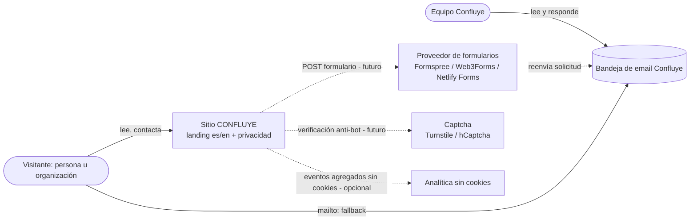

# Arquitectura — confluye

## Estilo y justificación
**Sitio estático generado en build (Astro SSG) con JS de cliente mínimo y puerto/adaptador para el único punto de integración (envío del formulario).** Sin backend ni BD: todo el contenido es HTML precompilado servido desde CDN; la única interacción con terceros es el POST del formulario a un proveedor externo (hoy simulado por el adaptador `demo`). Es el estilo más simple que cumple rendimiento móvil, accesibilidad, seguridad/privacidad y portabilidad entre hostings. Facetas: interfaz=web, despliegue=cloud, datos=sin-estado, arquitectura=script, integración=apis-terceros, regulación=datos-personales.

Atributos que mandan: (1) rendimiento móvil (RNF-02/14), (2) accesibilidad WCAG 2.2 AA (RNF-04), (3) seguridad y protección de datos (RNF-06/08/11). Restricciones duras: 100 % estático portable con `base` de subruta (RNF-10), sin backend propio, Ley 29733.

Decisiones: [ADR-0002](adr/0002-sitio-estatico-astro.md) (Astro SSG, TS estricto, CSS propio, i18n), [ADR-0003](adr/0003-adaptador-envio-formulario.md) (adaptador de envío y guardia de build), [ADR-0004](adr/0004-hosting-preview-produccion.md) (GitHub Pages preview; Vercel/Netlify producción).

## C4 — Contexto


## C4 — Contenedores
```mermaid
flowchart TB
  subgraph navegador[Navegador del visitante]
    html[HTML/CSS estático<br/>páginas es/en]
    js[Scripts TS vanilla<br/>menú + formulario]
    adapter[FormSubmitter<br/>demo | real]
  end
  subgraph ci[GitHub]
    repo[(Repositorio)]
    actions[GitHub Actions<br/>CI + build Astro]
    pages[GitHub Pages<br/>preview, base /repo/]
  end
  prod[CDN producción<br/>Vercel o Netlify - pendiente]
  proveedor[Proveedor de formularios - futuro]
  captcha[Captcha - futuro]
  analitica[Analítica sin cookies - opcional]
  bandeja[(Bandeja email Confluye)]

  repo --> actions
  actions -->|dist/ SITE_ENV=preview| pages
  actions -.->|dist/ SITE_ENV=production| prod
  pages -->|HTTPS| html
  prod -.->|HTTPS + cabeceras| html
  html --> js --> adapter
  adapter -.->|fetch HTTPS JSON/urlencoded, timeout 10 s| proveedor
  js -.-> captcha
  html -.-> analitica
  proveedor -.-> bandeja
```
En preview el adaptador `demo` no hace peticiones de red (CSP `connect-src 'self'`).

## Estructura de carpetas
```
src/
  pages/            index.astro, privacidad.astro, 404.astro, en/index.astro, en/privacy.astro
  layouts/          BaseLayout.astro (head, SEO, hreflang, CSP, skip link), LegalLayout.astro
  components/       Header, Nav (menú móvil), LangSwitch, Hero, sections/*, ContactForm, Footer, SocialLinks
  content/
    es/  en/        *.json por sección (hero, concept, value, audiences, services, approach, form, footer, seo) + privacy.md
    site.json       datos no traducibles: email, titular legal, redes {url, demo}
    schema.ts       esquemas zod de contenido
  content.config.ts colección "legal" (privacy.md)
  lib/
    form/
      schema.ts     tipos, límites, SERVICE_IDS, validateContact() (TS puro)
      payload.ts    buildPayload() (trim, condicionales, consentimiento)
      submitter.ts  FormSubmitter, SubmitResult, submitWithTimeout()
      factory.ts    createSubmitter(config) — único importador de adapters
      adapters/     demo.ts, <proveedor>.ts (pendiente)
    i18n/           routes.ts (equivalencias es/en), getContent(locale), ui.ts
    config/         env.ts (lectura astro:env), deploy-guard.ts (assertDeployConfig)
  integrations/     build-guard.ts (hooks astro:config:setup / astro:build:done)
  scripts/          contact-form.ts (DOM, estados, aria-live), nav.ts, analytics.ts (opcional)
  styles/           tokens.css, reset.css, global.css
public/             favicon, og-image, fonts/, robots.txt (generado por entorno), _headers (Netlify)
tests/
  unit/             schema, payload, adapters (contrato), submitter (timeout), i18n-parity, deploy-guard, headers-sync
  e2e/              navegación, menú, formulario (estados, demo, fallos), i18n, a11y (axe), layout (barrido), seo
vercel.json · astro.config.mjs · .nvmrc · lighthouserc.json · playwright.config.ts · vitest.config.ts
```

## Módulos y reglas de dependencia
| Módulo | Responsabilidad | Puede depender de |
|--------|-----------------|-------------------|
| `pages/`, `layouts/` | Composición por idioma, SEO, CSP, hreflang | `components/`, `lib/i18n`, `lib/config`, `content` |
| `components/` | Presentación accesible, sin lógica de negocio | `lib/i18n`, `lib/form/schema` (límites, SERVICE_IDS), `styles` |
| `scripts/contact-form.ts` | Binding DOM: validación, estados, foco, aria-live | `lib/form/schema`, `payload`, `submitter`, `factory` |
| `lib/form/schema`, `payload` | Dominio del formulario (puro, sin DOM ni framework) | nada externo |
| `lib/form/submitter` | Puerto y timeout | `schema` (tipos) |
| `lib/form/factory` | Selección de adaptador por config | `submitter`, `adapters/*`, `lib/config` |
| `lib/form/adapters/*` | Traducción payload ↔ proveedor; mapeo a `SubmitResult` | `submitter`, `schema` (tipos) |
| `lib/i18n` | Rutas y carga de contenido tipado | `content` |
| `lib/config`, `integrations/` | Env tipado y guardia de build | `astro:env`, `lib/form/schema` |

Reglas (forzadas con ESLint `no-restricted-imports` + `import-x/no-cycle`): componentes y scripts **no importan `adapters/`** (solo vía `factory`); `lib/form/{schema,payload,submitter}` no importan `astro:*` ni DOM; sin dependencias cíclicas; nada de `console.*` en `src/`.

## Atributos de calidad → tácticas
| Atributo | Táctica |
|----------|---------|
| Rendimiento móvil (RNF-02/03/14/19) | SSG sin runtime de framework; JS vanilla diferido (≤ 30 KB gz); CSS con ámbito + tokens (≤ 30 KB gz); `<Picture>` AVIF/WebP con `srcset/sizes`, imagen LCP con `fetchpriority=high` y sin lazy; fuentes autoalojadas `woff2` con `font-display: swap` y subset; analítica/captcha cargados tras interacción; assets con hash e `immutable`; Lighthouse CI con presupuestos |
| Accesibilidad (RNF-04/18, RF-07/08/10) | HTML semántico, un h1, skip link, foco visible ≥ 3:1, menú con `aria-expanded` y cierre con Esc, errores con `aria-describedby`/`aria-invalid` + resumen + foco al primer error, `aria-live` para estados, objetivos ≥ 44 px, `prefers-reduced-motion`; axe en cada estado en e2e |
| Seguridad y privacidad (RNF-06/07/08/11) | CSP por hash (`security.csp`) sin `unsafe-inline`; cabeceras completas en producción; sin secretos en cliente; sin PII en URL/storage/consola; honeypot + captcha + rate limit de proveedor; payload mínimo; guardia de build (demo, endpoint, placeholders); acciones fijadas por SHA; `npm audit`, gitleaks, Dependabot, license-checker |
| Mantenibilidad (RNF-09/16) | TS strictest; contenido por idioma en archivos con zod; test de paridad es/en; dominio del formulario puro y testeado (≥ 80 %); puerto/adaptador; ESLint (complejidad < 10), Stylelint, Prettier, `astro check` en CI |
| Portabilidad (RNF-10) | Salida `static`; `site`/`base` y config por variables; Node fijado (`.nvmrc`, `engines`), `npm ci` con lockfile; `_headers` + `vercel.json` sincronizados por test; build doble comparando hashes |
| Fiabilidad (RNF-05) | Timeout 10 s con AbortController; resultados tipados que nunca lanzan; fallback mailto; datos del formulario conservados ante error; contenido completo sin JS |
| Mobile-first (RNF-17, RF-13) | CSS base 360 px, solo `min-width` (Stylelint); tipografía `clamp()`; `scroll-padding-top` para cabecera fija; barrido de viewports 320–1920 en e2e |

## Cadena de herramientas
- **Gestor de paquetes: npm** (con `package-lock.json` y `npm ci`). Motivo: viene con Node (sin herramienta extra que fijar), los RNF ya se expresan con `npm ci`/`npm audit` (RNF-07/10) y `withastro/action` lo detecta por el lockfile. pnpm sería más rápido y estricto con dependencias fantasma, pero no aporta lo suficiente en un proyecto de este tamaño.
- **Tipos**: `astro check` (+ `tsc --noEmit` para tests/config).
- **Lint/format**: ESLint flat config (`typescript-eslint` strict, `eslint-plugin-astro` + reglas jsx-a11y, `complexity: 9`, `no-console`, `no-restricted-imports`, `import-x/no-cycle`); Prettier (+ `prettier-plugin-astro`); Stylelint (`stylelint-config-standard`, `media-feature-name-disallowed-list: ["max-width"]` y `media-feature-range-notation: "prefix"` para forzar `min-width`).
- **Unit (Vitest)**: schema/validación, payload, adaptadores (contrato con `fetch` simulado: 2xx/400/422/429/5xx/red/timeout), `submitWithTimeout` (fake timers), paridad i18n, guardia de build, sincronía de cabeceras, ausencia de placeholders. Cobertura v8 ≥ 80 % en `src/lib/`.
- **E2E (Playwright)**: proyectos móvil ≈360×800, tablet ≈768×1024, escritorio ≈1440×900 en Chromium y WebKit, más escritorio en Firefox; `@axe-core/playwright` por página y estado; barrido de viewports; bounding boxes táctiles; inspección de red/storage/cookies; `page.clock` para timeout.
- **Lighthouse CI** (`@lhci/cli`, móvil, 3 corridas, mediana) con aserciones de `nfr.md` (LCP, CLS, TBT, pesos, ≥ 90 en 4 categorías) sobre `dist/` servido localmente; corrida adicional contra la preview desplegada.
- **Seguridad/suministro**: `npm audit --omit=dev --audit-level=high`, gitleaks, Dependabot (npm + actions), `license-checker`.
- **CI (GitHub Actions)**: `ci.yml` en PR y push (install → lint → typecheck → unit → build preview → e2e → lhci → audit/gitleaks); `deploy-preview.yml` tras CI verde en `main`.

Comandos previstos: `npm ci` · `npm run dev` · `npm run build` (`astro check && astro build`) · `npm run preview` · `npm test` · `npm run test:coverage` · `npm run lint` (eslint + stylelint + prettier --check) · `npm run typecheck` · `npm run e2e` · `npm run lhci`.

## Riesgos técnicos
| Riesgo | Impacto | Mitigación |
|--------|---------|------------|
| CSP por hash de Astro no cubre scripts de terceros (captcha/analítica) o `is:inline` | Alto (rompe RNF-06 o la funcionalidad) | Evitar `is:inline`; declarar orígenes en `scriptDirective.resources`; test e2e sin errores CSP en consola |
| Preview en GitHub Pages sin cabeceras (clickjacking, sin HSTS propio) | Medio | Solo modo demo (sin PII); cabeceras completas en producción; `noindex` |
| `base` de subruta rompe enlaces/assets | Medio | Enlaces solo vía `BASE_URL`/`astro:i18n`; e2e corre contra el build con `base` |
| Proveedor de formulario aún no elegido (DPA, transferencia internacional, captcha accesible) | Alto (bloquea producción) | Guardia de build; ADR posterior con criterios de PRD §7 |
| Presupuesto JS/CSS al añadir captcha | Medio | Carga diferida tras primera interacción con el formulario; excluido del presupuesto inicial por RNF-02 |
| Vercel Hobby no admite uso comercial | Medio (coste) | Criterio explícito en ADR-0004 |
