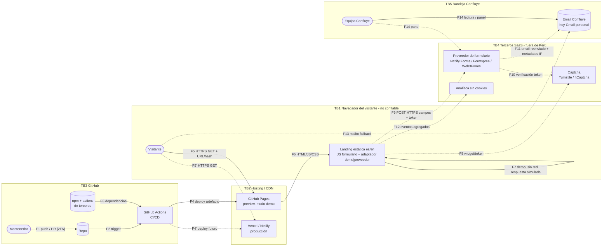

# Modelo de amenazas (STRIDE) — confluye

Versión 0.1 (2026-10-27). Track critical. Fuentes: PRD §1, RF-08..12, RF-15..17, §6, §7; `nfr.md` (RNF-06, 07, 08, 10, 11); `compliance.md`. Escala: A alto · M medio · B bajo.

## Activos y límites de confianza

**Activos**
- A1 Datos del envío: nombre, email, teléfono, organización, mensaje (≤ 500, **puede contener datos sensibles de salud/emociones**), evidencia de consentimiento.
- A2 Bandeja de email de Confluye (provisionalmente Gmail personal) y panel del proveedor: acumulan A1 hasta 12 meses.
- A3 Integridad del sitio publicado: repo, workflows de GitHub Actions, artefacto estático. Un compromiso permite inyectar JS que capture A1.
- A4 Marca y dominio: confianza del visitante, dominio propio futuro, registros DNS.
- A5 Disponibilidad del canal de captación: endpoint y cuota del proveedor, entrega de emails.
- A6 Configuración y secretos: endpoint y claves públicas (configuración), tokens de despliegue y claves privadas del captcha (secretos).

**Fronteras de confianza**
- TB1 Navegador del visitante (no confiable): todo lo que entra por URL, hash o campos es entrada hostil.
- TB2 Hosting/CDN: GitHub Pages (preview, sin cabeceras propias) / Vercel o Netlify (producción).
- TB3 GitHub: repo, Actions y dependencias externas (npm, actions de terceros). Plano de construcción.
- TB4 Terceros SaaS fuera de Perú: proveedor de formulario, captcha, analítica (flujo transfronterizo, Ley 29733 art. 15).
- TB5 Bandeja de Confluye y equipo (lectura humana de contenido controlado por el visitante).

## Diagrama de flujo de datos

Línea continua: activo en preview. Discontinua: solo producción (o preview si se activa analítica).

| ID | Componente | STRIDE | Amenaza | Impacto | Prob. | Mitigación | Estado |
|----|------------|--------|---------|---------|-------|------------|--------|
| T-01 | F9 Formulario → FP | S/D | Bots y spam masivo (evaden validación de cliente) llenan la bandeja, ocultan contactos reales y llevan phishing al equipo | M | A | Honeypot (RF-09), captcha verificado en servidor por el proveedor (F10), rate limit y dominio de origen permitido en el proveedor, validación servidor (RF-08); SR-01 | pendiente producción |
| T-02 | FP (cuota) | D | Agotamiento de la cuota del plan gratuito o bloqueo por abuso: solicitudes legítimas rechazadas (429) o perdidas en silencio | A | M | SR-01 reduce volumen; alerta de cuota y monitor de entrega, mensaje 429 + fallback (RF-10), plan de pago evaluado; SR-02 | pendiente producción |
| T-03 | UI (F5/F6) | T/E | XSS DOM por hash/query (selector de idioma conserva el hash, RF-12), mensajes de error o confirmación que reflejan campos, contenido inyectado vía `set:html` | A | B | Solo `textContent`; prohibido `innerHTML`/`set:html` con datos no confiables; hash validado contra lista de anclas; CSP sin `unsafe-inline` (RNF-06); test de payloads (RF-08); SR-03 | diseñada |
| T-04 | F11 Email al equipo | T/I | Inyección HTML/enlaces o Reply-To manipulado en el email reenviado: phishing interno, robo de la cuenta de la bandeja | M | M | Notificación en texto plano o escapada; Reply-To solo con email validado; sin auto-enlazado de contenido del usuario; SR-04 | pendiente producción |
| T-05 | TB2 / marca | S | Clon de la landing o typosquatting que capta datos con la marca; preview `*.github.io` indexada y tomada por sitio oficial (con enlaces demo, RF-15) | M | M | Preview `noindex` + banner "sitio de prueba", canonical solo en producción; dominio propio con HSTS; vigilancia de dominios similares; SR-05 | pendiente producción |
| T-06 | GHP preview | T | Clickjacking: GitHub Pages no admite `frame-ancestors` ni `X-Frame-Options` (meta CSP lo ignora) | B (demo sin datos) / M prod | B | Preview: aceptado (RNF-06), frame-busting JS opcional. Producción: `frame-ancestors 'none'` + XFO DENY (RNF-06); SR-16 | aceptada (preview) / pendiente producción |
| T-07 | F3 npm | T/E | Paquete comprometido o typosquat: script de instalación en CI o JS en el bundle que exfiltra el formulario (skimmer) | A | M | `npm ci` + lockfile (RNF-10), `npm audit` high bloqueante, Dependabot, mínimas dependencias runtime, `connect-src` restringido (RNF-07); SR-06 | diseñada |
| T-08 | GHA | T/E | Action de terceros con tag mutable comprometida, `GITHUB_TOKEN` con permisos amplios, `pull_request_target` o interpolación de `github.event.*` en `run:`: despliegue de código malicioso | A | M | Actions fijadas por SHA, `permissions` mínimos por job, environment protegido, Dependabot de actions, actionlint/zizmor; SR-07 | diseñada (aplicar ya en preview) |
| T-09 | GHA secretos | I | Fuga de token de despliegue (Vercel/Netlify) o clave secreta de captcha en repo, logs o forks | A | B | Gitleaks en CI (RNF-07), secretos solo en environments protegidos, OIDC si hay soporte, rotación; claves privadas nunca en cliente; SR-08 | diseñada |
| T-10 | F1 cuenta GitHub | S/E | Robo de la cuenta del mantenedor (phishing, PAT): push directo a `main`, cambio de Pages, borrado del repo | A | M | 2FA (passkey/TOTP), protección de `main` con PR + checks, sin PAT clásicos, alertas de seguridad; SR-09 | diseñada (aplicar ya en preview) |
| T-11 | MB / FP (A1, A2) | I | Datos sensibles en el mensaje almacenados en proveedor y Gmail personal; robo de esa cuenta expone todos los contactos (incidente con notificación a la ANPD en 48 h) | A | M | Aviso y límite 500 (RF-08), bandeja dedicada de Confluye con 2FA y mínimo acceso, sin reenvíos automáticos, borrado y retención ≤ 12 meses (compliance), plan de incidentes; SR-10 | pendiente producción |
| T-12 | UI / F12 | I | PII en URL (GET nativo sin JS), consola, storage, Referer o eventos de analítica con contenido del formulario | M | M | Siempre POST, sin GET de respaldo; sin JS se muestra el email (RF-10); sin storage (RF-10), `no-console` en build de producción, eventos sin campos (RF-17), Referrer-Policy (RNF-06); SR-11 | diseñada |
| T-13 | F7 modo demo | R/D | (a) El visitante de la preview cree que envió y espera respuesta; (b) producción publicada con adaptador `demo`: pérdida silenciosa de todos los contactos | M (a) / A (b) | M | Aviso de prueba visible (RF-10), build de producción falla con `demo` o sin endpoint (RF-10), smoke test post-deploy con envío canario de extremo a extremo, banner global en preview; SR-12 | diseñada |
| T-14 | F9/F11 metadatos | I | El proveedor registra IP, user agent y huella; perfilado o brecha del proveedor | M | M | Proveedor con DPA y opción de minimizar o truncar IP, retención configurada, declarado en la política (RNF-11); SR-13 | pendiente producción |
| T-15 | TB4 transferencia | I | Flujo transfronterizo (EE. UU.) sin garantías, sin informar o sin comunicar a la ANPD | M | A (si se omite) | DPA o cláusulas, registro de encargados, país en la política, comunicación en la inscripción del banco de datos (compliance); SR-13 | pendiente producción |
| T-16 | F13 mailto | I/D | Email personal (Gmail) publicado en HTML: scraping, spam, phishing dirigido y exposición de la identidad personal | M | A | Dirección dedicada (dominio propio o cuenta exclusiva), filtro antispam, ofuscación ligera (no es control fuerte), no publicar el Gmail personal tampoco en preview; SR-14 | pendiente producción |
| T-17 | DNS / TB2 | S/T | Takeover de subdominio al migrar: CNAME colgante a GitHub Pages o a un proyecto Vercel/Netlify eliminado; registrador sin 2FA | A | M | Dominio verificado en GitHub, procedimiento de migración (alta, cambio DNS, baja, limpieza), CAA, 2FA y bloqueo en el registrador; SR-15 | pendiente producción |
| T-18 | F8 / F12 scripts de terceros | T/I | CDN del captcha o analítica comprometido inyecta JS; el captcha añade cookies o huella y rompe el "sin cookies" (RF-17) | M | B | Captcha cargado solo al interactuar con el formulario, analítica autoalojada o con SRI (RNF-07), allowlist en `script-src`/`frame-src`/`connect-src` por entorno, test de cookies; SR-17 | pendiente producción |
| T-19 | F9 consentimiento | R | Sin evidencia del consentimiento ante una reclamación ARCO o de la ANPD | M | M | Payload con consentimiento, versión de política, idioma y marca de tiempo (RF-11); export del proveedor | pendiente producción |
| T-20 | F14 panel FP | S/E | Toma de la cuenta del proveedor: lectura masiva, cambio del email de destino (desvío de contactos) | A | B | 2FA, cuenta de Confluye (no personal), alertas de cambios de configuración; SR-09, SR-10 | pendiente producción |

Leyenda: S suplantación · T manipulación · R repudio · I divulgación · D denegación de servicio · E elevación de privilegios. Estado: *diseñada* = especificada en RF/RNF/SR y verificable en CI; *pendiente producción* = obligatoria antes de recoger datos reales; *aceptada* = riesgo residual asumido con justificación.

## Preview vs producción

| Aspecto | Preview (GitHub Pages, hoy) | Producción (Vercel/Netlify, futuro) |
|---|---|---|
| Datos personales | No transmite (adaptador `demo`); sin tratamiento | Envío real a proveedor, bandeja y metadatos; Ley 29733 plena |
| Cabeceras | CSP por `<meta>` sin `frame-ancestors`; HTTPS de GitHub; sin HSTS propio | CSP completa, HSTS, XFO/`frame-ancestors`, nosniff, Referrer y Permissions-Policy (RNF-06) |
| Anti-spam | Honeypot; sin captcha | Honeypot + captcha verificado en servidor + rate limit |
| Indexación y marca | `noindex`, banner de prueba, redes demo | Indexable, canonical, dominio propio, redes reales u ocultas |
| Email visible | No publicar el Gmail personal (usar placeholder no real) | Dirección dedicada de Confluye |
| Riesgos aceptados | Clickjacking (T-06), ausencia de HSTS propio | Ninguno de severidad A |

**Checklist bloqueante antes de producción**
- [ ] Adaptador ≠ `demo` y endpoint configurado; el build falla si no (RF-10); smoke test canario post-deploy OK (SR-12).
- [ ] Cabeceras completas y Observatory ≥ A verificado en el dominio real (RNF-06, SR-16).
- [ ] Captcha verificado en servidor, honeypot, rate limit y dominio permitido en el proveedor (SR-01); alerta de cuota (SR-02).
- [ ] Proveedor con DPA, país, retención e IP minimizada; registro de encargados (SR-13).
- [ ] Bandeja dedicada con 2FA, sin reenvíos, email de notificación en texto plano (SR-04, SR-10, SR-14).
- [ ] 2FA en GitHub, hosting, registrador, proveedor y email; `main` protegida (SR-09).
- [ ] DNS: dominio verificado en GitHub, sin registros colgantes, CAA (SR-15).
- [ ] Política es/en sin placeholders, titular identificado, inscripción ANPD resuelta (RF-11, RF-16, compliance).
- [ ] 0 vulnerabilidades altas, 0 secretos, actions fijadas por SHA (RNF-07, SR-06..08).
- [ ] Test E2E: sin PII en URL, storage, consola ni cookies (SR-11, RF-17).
- [ ] Plan de incidentes (notificación a la ANPD en 48 h) y procedimiento de borrado de datos sensibles listos.

## Requisitos de seguridad derivados (backlog)

| ID | Requisito | ASVS 5.0 (L2) | Amenazas |
|---|---|---|---|
| SR-01 | Anti-automatización en servidor: token de captcha verificado por el proveedor, honeypot descartado, rate limit y restricción de dominio de origen | V2 Lógica de negocio / anti-automatización | T-01, T-02 |
| SR-02 | Monitorización de cuota y entrega del proveedor con alerta al equipo; manejo 429 con fallback | V2; V16 | T-02 |
| SR-03 | Codificación de salida en cliente: regla de lint que prohíbe `innerHTML`/`set:html`/`document.write` con datos no confiables (p. ej. eslint-plugin-no-unsanitized); hash y query validados contra allowlist; test con payloads XSS | V1 Codificación; V3 Frontend | T-03 |
| SR-04 | Email de notificación en texto plano o escapado; Reply-To solo con email validado | V1 | T-04 |
| SR-05 | Preview `noindex` + banner global de prueba; canonical y hreflang solo hacia el dominio de producción | V3 | T-05, T-13 |
| SR-06 | Cadena npm: `npm ci`, lockfile, `npm audit --audit-level=high` bloqueante, Dependabot (npm), OSV-Scanner, revisión de PR de dependencias | V15 Componentes | T-07 |
| SR-07 | Endurecimiento de workflows: actions por SHA completo, `permissions: contents: read` global y elevación solo en el job de deploy, environment protegido, sin `pull_request_target`, sin `${{ github.event.* }}` en `run:`, Dependabot (github-actions), actionlint/zizmor en CI | V13 Configuración; V15 | T-08 |
| SR-08 | Gestión de secretos: gitleaks en CI y pre-commit, secretos solo en environments protegidos, OIDC si hay soporte, rotación documentada | V13 | T-09 |
| SR-09 | Cuentas: 2FA obligatoria en GitHub, hosting, registrador, proveedor y email; `main` protegida con PR y checks; sin PAT clásicos; revisión trimestral de accesos | control operativo | T-10, T-20 |
| SR-10 | Bandeja dedicada de Confluye (no personal) con 2FA y mínimo acceso, sin reenvíos automáticos, borrado de datos sensibles y retención ≤ 12 meses, plan de incidentes 48 h | V14 Protección de datos | T-11, T-20 |
| SR-11 | Sin PII fuera del POST: método POST, sin GET de respaldo, `console.*` eliminado en build de producción, sin storage, eventos de analítica sin campos; test E2E | V14 | T-12 |
| SR-12 | Guardas del modo demo: fallo de build (RF-10) + smoke test post-deploy en producción (endpoint real en el bundle, sin aviso demo, envío canario recibido) | V13; V15 | T-13 |
| SR-13 | Due diligence de proveedores: DPA, país, retención, minimización de IP, export/borrado; registro de encargados | V14 | T-14, T-15 |
| SR-14 | Email público dedicado (nunca el Gmail personal) con filtro antispam | control operativo | T-16 |
| SR-15 | Procedimiento de migración de hosting y DNS sin registros colgantes; dominio verificado en GitHub; CAA; 2FA y bloqueo en el registrador | V13 | T-17 |
| SR-16 | Test automatizado post-deploy de cabeceras (Observatory ≥ A) con excepciones de captcha documentadas; frame-busting opcional en preview | V3; V13 | T-06 |
| SR-17 | Scripts de terceros: captcha cargado bajo demanda, analítica autoalojada o con SRI, allowlist CSP por entorno, test sin cookies | V3 | T-18 |
