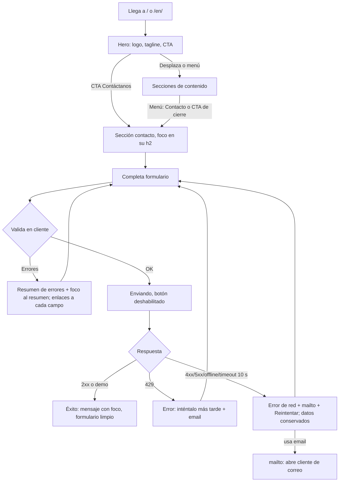
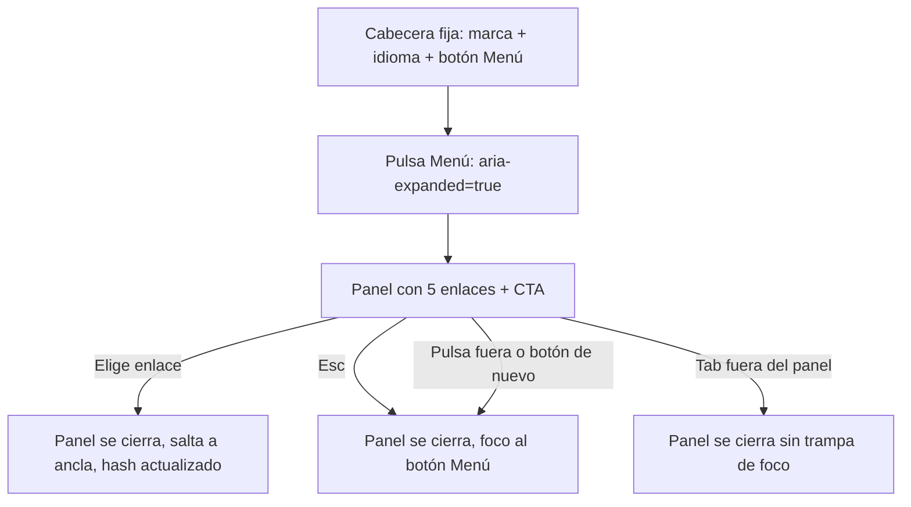

# UX y accesibilidad — confluye

Fase design. Fuente de copy: `docs/research/contenido-cliente.md` (no se reescribe; solo se reorganiza). Requisitos: PRD RF-01..RF-13, RF-15, RF-16 y NFR de usabilidad/a11y/mobile (RNF-14, RNF-17). Dirección visual elegida por el cliente: **cálida y orgánica** (formas fluidas que evocan la "confluencia" del logo, fondos crema, serif humanista en títulos, mucho aire).

## 0. Principios

- Consistencia: un solo patrón por tipo de contenido (tarjeta, acordeón, botón, campo).
- Prevención de errores: etiquetas visibles, ayudas antes del campo, contador de caracteres, consentimiento no premarcado, `type`/`inputmode`/`autocomplete` correctos.
- Feedback inmediato: estados de envío, éxito y error en regiones `aria-live`, sin perder lo escrito.
- Lenguaje del usuario: tuteo cercano, sin jerga clínica; es/en con paridad total de claves.
- Mobile-first real: el diseño base es 360 px; escritorio es una ampliación (`min-width` ≈768/1024/1440).
- Mejora progresiva: todo el contenido, la navegación y el contacto alternativo funcionan sin JS.

## 1. Flujos de las tareas clave

### 1.1 Tarea A: entender qué es CONFLUYE y contactar (objetivo ≤ 3 acciones desde la carga)



Mínimo de pasos: CTA (1) → rellenar campos obligatorios (nombre, email, tipo, consentimiento = 4 controles) → enviar. Recuperación: ningún error borra datos; el usuario siempre dispone del email como salida.

### 1.2 Tarea B: navegar por el sitio en móvil



### 1.3 Tarea C: cambiar de idioma

Selector (es | en) en cabecera y footer → navega a la misma página en el otro idioma conservando el hash → el lector de pantalla anuncia el nuevo `lang` al cargar. Error: si el hash no existe se muestra el inicio, sin error.

### 1.4 Tarea D: leer las líneas de un público (acordeón)

Resumen del público (`<summary>`, ≥ 44 px) → Enter/Espacio abre → lista de viñetas visible → se puede abrir varios a la vez. Sin JS: todos abiertos.

## 2. Arquitectura de información

Una página, orden narrativo "quiénes somos → qué ofrecemos → cómo → contacto". `scroll-margin-top` = altura de cabecera + 8 px en todas las anclas. Los mismos IDs en es/en (permite conservar el hash al cambiar de idioma).

| # | Ancla | Sección (h2) es / en | Entrada de menú es / en | Contenido del copy |
|---|---|---|---|---|
| 0 | `#inicio` | Hero (h1 = tagline) | (logo = inicio) | Tagline, CTA |
| 1 | `#concepto` | Un espacio de encuentro humano / A space for human encounter | Quiénes somos / About | Mapa del tagline (4 ideas) + "Concepto central" + descripción del emprendimiento (4 párrafos) |
| 2 | `#proposito` | Nuestro propósito / Our purpose | (dentro de Quiénes somos) | "Propósito" completo, como cita grande |
| 3 | `#valor` | Propuesta de valor / Our value | Propuesta / Value | Intro + 6 dimensiones |
| 4 | `#publicos` | Públicos y ámbitos / Who we work with | Públicos / Audiences | Intro + 5 públicos (5, 5, 5, 6, 6 viñetas) |
| 5 | `#modalidades` | Modalidades de servicio / Ways we work | Servicios / Services | Intro + 8 modalidades |
| 6 | `#enfoque` | Enfoque diferencial / Our approach | Enfoque / Approach | Premisa + preguntas destacadas + párrafo de cierre |
| 7 | `#impacto` | Impacto social esperado / Expected social impact | (dentro de Enfoque) | 5 niveles + "En síntesis, CONFLUYE…" (una sola vez) |
| 8 | `#contacto` | Hablemos / Let's talk | Contacto / Contact (botón) | Formulario |
| 9 | footer | (landmark `contentinfo`) | — | Titular, política, email, redes, idioma, año |

Menú: 5 enlaces + botón de contacto (Quiénes somos, Propuesta, Públicos, Servicios, Enfoque | Contacto). Cabe en 768 px sin desbordar; los títulos largos se reservan al h2.

Mapa de encabezados: h1 (hero) → h2 por sección → h3 por tarjeta/público/modalidad/dimensión/nivel. Sin saltos.

### 2.1 Cómo condensar el copy sin perder contenido

| Bloque | Patrón | Notas |
|---|---|---|
| Tagline y 4 ideas (CONFLUYE, Personas, Bienestar, Se construye) | Fila de 4 "chips" con su significado, en `#concepto` | Es contenido del cliente ("Esta combinación…"); usar solo las 4 definiciones, sin el comentario meta en primera persona ("Mi propuesta…"). **Pendiente de confirmar con el cliente** |
| Concepto central | Texto lead grande (step-1), 1 párrafo | |
| Descripción (4 párrafos) | 2 columnas desde 1024; en móvil el 1.º párrafo visible y los 3 siguientes en `<details>` "Leer más" abierto por defecto sin JS | El texto íntegro queda en el DOM y es indexable |
| Propósito | Cita grande sobre fondo teal con forma orgánica | Texto completo |
| 6 dimensiones | Lista `<ul>` de 6 tarjetas (nombre en h3 + descripción) | 1 col (360), 2 col (768), 3 col (1024) |
| 5 públicos | Acordeón `<details>` por público; ≥ 1024 todos abiertos en tarjetas (JS añade/quita `open` según ancho; sin JS abiertos) | Cada `<summary>` lleva h3 + "5 líneas"; viñetas en `<ul>` |
| 8 modalidades | Lista de 8 tarjetas con icono + nombre + descripción; misma fuente de datos que el `<select>` | 1 col, 2 col (768), 4 col (1440) |
| Enfoque | Premisa en párrafo; las 4 preguntas como `<blockquote>`/lista destacada con tipografía serif grande; párrafo de cierre | Las preguntas son lista (`<ul>`) para lectores de pantalla |
| 5 niveles de impacto | "Línea de confluencia" vertical en móvil / horizontal en 1024: 5 hitos numerados en `<ol>` | El orden individual→comunitario es significativo, por eso `<ol>` |
| "En síntesis…" | Párrafo de cierre bajo los niveles, aparece una sola vez | |

Regla: cualquier colapso usa elementos nativos (`<details>`) y no oculta contenido con `display:none` sin control accesible.

## 3. Wireframes (ASCII)

Leyenda: `[ ]` botón/campo, `(~)` forma orgánica decorativa (`aria-hidden`), `▾` acordeón.

### 3.1 Hero

360 px (cabe en 360×640 sin scroll: cabecera 56 + marca 112 + h1 ≈ 215 + CTA 48 + márgenes):

```
┌────────────────────────┐ 360
│ ◎ CONFLUYE   ES|EN  ☰ │ 56 px, fija
├────────────────────────┤
│   (~)                  │
│      ┌──────┐          │
│      │ logo │ 112×112  │
│      └──────┘          │
│ Personas que se        │
│ encuentran.            │ h1 serif 36 px
│ Bienestar que se       │
│ construye.             │
│ [ Contáctanos       ]  │ CTA 100% ancho, 48 px
│  Servicios y programas │ (texto de apoyo opcional, 1 línea)
│  ~~~~~~~~ ola ~~~~~~~~ │
└────────────────────────┘
```

768 px:

```
┌───────────────────────────────────────────────┐
│ ◎ CONFLUYE  Quiénes·Propuesta·Públicos·…  ES|EN │
├───────────────────────────────────────────────┤
│ Personas que se encuentran.      ┌──────────┐ │
│ Bienestar que se construye.      │   logo   │ │
│ Lead 1 frase                     │ 280×280  │ │
│ [ Contáctanos ]                  └──────────┘ │
│ ~~~~~~~~~~~~~~~~ ola ~~~~~~~~~~~~~~~~~~~~~~~ │
└───────────────────────────────────────────────┘
```

1440 px (contenido máx. 1200 px centrado, 12 col):

```
┌────────────────────────────────────────────────────────────────────────┐
│ ◎ CONFLUYE      Quiénes  Propuesta  Públicos  Servicios  Enfoque  [Contacto]  ES|EN │
├────────────────────────────────────────────────────────────────────────┤
│  (~ blob crema-peach)                                                  │
│  Personas que se encuentran.                    ┌───────────────┐      │
│  Bienestar que se construye.      (h1 64 px)    │     logo      │      │
│  [ Contáctanos ]  Ver servicios (enlace)        │    420×420    │      │
│                                                 └───────────────┘      │
│ ~~~~~~~~~~~~~~~~~~~~~~~~~~~~ ola ~~~~~~~~~~~~~~~~~~~~~~~~~~~~~~~~~~~~~ │
└────────────────────────────────────────────────────────────────────────┘
```

### 3.2 Sección de tarjetas (6 dimensiones)

```
360                      768                         1440 (3 col, 1024+)
┌──────────────┐         ┌──────────┬──────────┐     ┌────────┬────────┬────────┐
│ ⬭ Personal   │         │ Personal │Relacional│     │Personal│Relacion│ Grupal │
│ descripción  │         ├──────────┼──────────┤     ├────────┼────────┼────────┤
├──────────────┤         │ Grupal   │Organizac.│     │Organiz.│Comunit.│Educat. │
│ ⬭ Relacional │         ├──────────┼──────────┤     └────────┴────────┴────────┘
│ …            │         │Comunit.  │Educativo │     (tarjetas con borde superior en
│ (6 apiladas) │         └──────────┴──────────┘      color alterno teal/terracota/hoja)
└──────────────┘
```

### 3.3 Públicos (acordeón en móvil, tarjetas en escritorio)

```
360                           768 (acordeón 2 col)           1440 (todo abierto, 3+2)
┌────────────────────────┐    ┌─────────────┬─────────────┐   ┌──────┬──────┬──────┐
│ Niños y adolescentes ▾ │    │ Niños y a. ▾│ Jóvenes   ▾ │   │Niños │Jóven.│Adult.│
│ 5 líneas               │    ├─────────────┼─────────────┤   │• …   │• …   │• …   │
├────────────────────────┤    │ Adultos   ▾ │ Organiz.  ▾ │   ├──────┴──┬───┴──────┤
│ Jóvenes              ▾ │    ├─────────────┴─────────────┤   │Organiz. │Comunid.  │
├────────────────────────┤    │ Comunidades y colectivos ▾│   │• … (6)  │• … (6)   │
│ Adultos              ▾ │    └───────────────────────────┘   └─────────┴──────────┘
│ …(abierto)             │
│  • viñeta              │
│  • viñeta              │
└────────────────────────┘
```

Cada `<summary>`: mín. 56 px de alto, icono chevron (rota 90° al abrir; sin movimiento con `prefers-reduced-motion`), texto + contador, borde visible ≥ 3:1.

### 3.4 Formulario de contacto

360 px (una columna; etiquetas arriba; objetivos ≥ 48 px):

```
┌────────────────────────┐
│ Hablemos (h2)          │
│ ┌ AVISO MODO DEMO ───┐ │  role="note", icono + texto (no solo color)
│ │ ⚠ Formulario de    │ │
│ │ prueba: tus datos  │ │
│ │ no se envían…      │ │
│ └────────────────────┘ │
│ ┌ Resumen de errores ┐ │  solo tras intento fallido, role="alert"
│ │ Hay 3 campos…      │ │
│ │ • Escribe tu nombre│ │  cada ítem es enlace al campo
│ └────────────────────┘ │
│ Nombre *               │
│ [____________________] │
│ Correo electrónico *   │
│ [____________________] │
│ Teléfono (opcional)    │
│ [____________________] │
│ Soy… *                 │
│ (•) Persona            │  radios en `fieldset`/`legend`
│ ( ) Organización       │
│ Organización *         │  solo si Organización
│ [____________________] │
│ Servicio de interés    │
│ [Selecciona…        ▾] │  9 opciones
│ Mensaje (opcional)     │
│ ℹ No incluyas info de  │  aviso vinculado con aria-describedby
│ salud ni datos emoc…   │
│ [____________________] │
│ [                    ] │
│                 0/500  │  contador
│ [ ] Acepto que…        │  checkbox 44×44, enlace a política
│ [   Enviar mensaje   ] │
│ ¿Prefieres escribir?   │
│ hola@… (mailto)        │
└────────────────────────┘
```

768 px: tarjeta crema-blanca centrada (máx. 640 px) con blob decorativo lateral; nombre+email en 2 columnas; resto 1 columna.

1440 px: 2 columnas: izquierda texto de invitación + email alternativo + redes; derecha formulario (máx. 560 px). Nombre/email y teléfono/tipo pueden ir en 2 columnas dentro del formulario.

## 4. Sistema de diseño

### 4.1 Tokens de color

Derivados del logo (teal/azul petróleo oscuro, melocotón/terracota, verde hoja, fondo blanco roto). Ratios calculados con la fórmula WCAG 2.x (luminancia relativa sRGB); redondeo a 2 decimales. **Verificar en CI** (axe + script de contraste sobre tokens) porque se calcularon a mano.

| Token | Hex | Uso |
|---|---|---|
| `--c-bg` | `#FBF7F0` | Fondo de página (crema) |
| `--c-surface` | `#FFFFFF` | Tarjetas, campos |
| `--c-surface-alt` | `#F3EBDD` | Franjas alternas, resumen de acordeón abierto |
| `--c-tint-teal` | `#E3EFEC` | Fondo suave de avisos informativos |
| `--c-text` | `#1F2D2E` | Texto principal |
| `--c-text-2` | `#4A5B5C` | Texto secundario, ayudas, contador |
| `--c-primary` | `#1F5F63` | Botón principal, enlaces, h2 |
| `--c-primary-hover` | `#174A4D` | Hover/active de primario |
| `--c-accent` | `#A8482A` | Terracota: eyebrows, números, acentos de texto |
| `--c-accent-soft` | `#F2B193` | Melocotón: solo decorativo/fondos de forma (no texto) |
| `--c-leaf` | `#6FA06A` | Verde hoja: solo decorativo |
| `--c-success` | `#2E6B3A` | Texto/icono de éxito |
| `--c-error` | `#B3261E` | Texto/borde/icono de error |
| `--c-error-bg` | `#FBEAE8` | Fondo de resumen de errores |
| `--c-focus` | `#1B4DB1` | Anillo de foco sobre fondos claros |
| `--c-border-input` | `#6B7C7D` | Borde de campos y controles |
| `--c-footer-bg` | `#173F42` | Footer / bloque de propósito |
| `--c-focus-on-dark` | `#FFD27A` | Anillo de foco sobre fondos oscuros |

Ratios (texto normal ≥ 4,5:1; texto grande ≥ 24 px o ≥ 18,66 px negrita, e iconos/bordes de UI ≥ 3:1):

| Par (primer plano / fondo) | Ratio | Criterio | Resultado |
|---|---|---|---|
| `text` / `bg` | 13,35:1 | 1.4.3 | AAA |
| `text` / `surface` | 14,26:1 | 1.4.3 | AAA |
| `text` / `surface-alt` | 12,04:1 | 1.4.3 | AAA |
| `text` / `tint-teal` | 12,10:1 | 1.4.3 | AAA |
| `text-2` / `bg` | 6,69:1 | 1.4.3 | AA |
| `text-2` / `surface` | 7,14:1 | 1.4.3 | AAA |
| `text-2` / `surface-alt` | 6,03:1 | 1.4.3 | AA |
| `text-2` / `tint-teal` | 6,06:1 | 1.4.3 | AA |
| `primary` (enlace/título) / `bg` | 6,84:1 | 1.4.3 | AA |
| `primary` / `surface-alt` | 6,17:1 | 1.4.3 | AA |
| `primary` / `tint-teal` | 6,20:1 | 1.4.3 | AA |
| `#FFFFFF` / `primary` (texto de botón) | 7,31:1 | 1.4.3 | AAA |
| `#FFFFFF` / `primary-hover` | 9,89:1 | 1.4.3 | AAA |
| `accent` / `bg` | 5,43:1 | 1.4.3 | AA |
| `accent` / `surface` | 5,79:1 | 1.4.3 | AA |
| `accent` / `surface-alt` | 4,89:1 | 1.4.3 | AA |
| `success` / `bg` | 5,99:1 | 1.4.3 | AA |
| `success` / `surface` | 6,40:1 | 1.4.3 | AA |
| `error` / `bg` | 6,12:1 | 1.4.3 | AA |
| `error` / `surface` | 6,54:1 | 1.4.3 | AA |
| `error` / `error-bg` | 5,61:1 | 1.4.3 | AA |
| `text` / `error-bg` | 12,20:1 | 1.4.3 | AAA |
| `border-input` / `surface` | 4,37:1 | 1.4.11 | AA |
| `border-input` / `bg` | 4,09:1 | 1.4.11 | AA |
| `focus` / `bg` | 7,17:1 | 2.4.11/1.4.11 | AA |
| `focus` / `surface` | 7,66:1 | 2.4.11/1.4.11 | AA |
| `bg` (texto crema) / `footer-bg` | 10,77:1 | 1.4.3 | AAA |
| `accent-soft` (enlaces en footer) / `footer-bg` | 6,29:1 | 1.4.3 | AA |
| `focus-on-dark` / `footer-bg` | 8,08:1 | 2.4.11 | AA |
| `accent-soft` / `bg` (decorativo) | 1,70:1 | — | No se usa para texto ni como único indicador |

Reglas de color:
- `accent-soft` y `leaf` no portan información ni texto (ratio < 3:1 sobre crema): solo decoración o fondo de formas.
- Foco: el anillo se separa del control con `outline-offset: 2px`, por eso su contraste se mide contra el fondo de la página y no contra el relleno del botón (`focus`/`primary` = 1,05:1 si estuviera pegado).
- Estados nunca solo por color: error = icono + texto + borde 2 px; éxito = icono de check + texto; enlaces subrayados en cuerpo de texto.
- Enlace/botón sobre fondo oscuro (`footer-bg`, propósito): texto crema, foco `focus-on-dark`.

### 4.2 Tipografía (autoalojada, licencia OFL, subset latin, `font-display: swap`)

Máx. 2 familias, 4 archivos woff2. Verificar peso real tras subsetting (presupuesto RNF-02: fuentes ≤ 80 KB; los tamaños de abajo son **estimados**, medir en CI y recortar con `pyftsubset` si se excede).

| Uso | Familia (OFL) | Archivo | Peso | Tamaño est. |
|---|---|---|---|---|
| Títulos (serif humanista cálida) | **Fraunces** (Undercase Type, OFL 1.1) | `fraunces-latin-600-normal.woff2` | 600 | ~28 KB |
| Citas/preguntas destacadas | Fraunces | `fraunces-latin-400-italic.woff2` | 400 itálica | ~30 KB |
| Texto y UI | **Source Sans 3** (Adobe, OFL 1.1) | `source-sans-3-latin-400-normal.woff2` | 400 | ~18 KB |
| Texto fuerte, botones, etiquetas | Source Sans 3 | `source-sans-3-latin-600-normal.woff2` | 600 | ~18 KB |

- Si el total supera 80 KB: eliminar la itálica de Fraunces (usar 600 normal para citas) → 3 archivos.
- Subset: U+0000-00FF, U+0131, U+0152-0153, U+02BB-02BC, U+02C6, U+02DA, U+02DC, U+2000-206F, U+20AC (cubre ñ, á, é, í, ó, ú, ü, ¿, ¡ y comillas). Probar `¿ ¡ ñ Ñ á` en la prueba visual.
- `@font-face` con `font-display: swap`, `<link rel="preload" as="font" type="font/woff2" crossorigin>` solo para Fraunces 600 y Source Sans 3 400. Fallbacks con métricas ajustadas (`size-adjust`, `ascent-override`) para minimizar CLS: `Georgia, 'Times New Roman', serif` y `system-ui, -apple-system, 'Segoe UI', Roboto, sans-serif`.
- Wordmark "CONFLUYE": Source Sans 3 600, mayúsculas, `letter-spacing: .18em` (evoca la fina espaciada del logo) como texto real, no imagen.
- Sin Google Fonts remoto (privacidad y RNF).

Escala fluida (base 360 → 1440; todo en `rem`, respeta el zoom del usuario; verificado el mínimo en 360 px):

| Token | `clamp()` | 360 px | 1440 px | Uso |
|---|---|---|---|---|
| `--step-0` | `clamp(1rem, .96rem + .2vw, 1.125rem)` | 16,1 px | 18 px | Texto, formulario, ayudas, contador (nunca < 16 px) |
| `--step-1` | `clamp(1.125rem, 1.06rem + .32vw, 1.3125rem)` | 18,1 px | 21 px | Lead, resumen de acordeón |
| `--step-2` | `clamp(1.25rem, 1.1rem + .7vw, 1.625rem)` | 20,1 px | 26 px | h3 |
| `--step-3` | `clamp(1.75rem, 1.4rem + 1.6vw, 2.75rem)` | 28,2 px | 44 px | h2 |
| `--step-4` | `clamp(2.25rem, 1.6rem + 3vw, 4rem)` | 36,4 px | 64 px | h1 |

Interlineado: texto 1,6; títulos 1,15-1,25. Medida de lectura máx. `65ch`. Sin texto justificado. `hyphens: manual`, `overflow-wrap: anywhere` en emails/URLs largos (evita scroll horizontal).

### 4.3 Espaciado, radios, sombras, movimiento

- Espaciado (base 4 px): `--s-1 .25rem`, `--s-2 .5rem`, `--s-3 .75rem`, `--s-4 1rem`, `--s-5 1.5rem`, `--s-6 2rem`, `--s-7 3rem`, `--s-8 4rem`, `--s-9 6rem`.
- Gutter de página: `clamp(1.25rem, 5vw, 3rem)` (20 px a 360). Sección: `padding-block: clamp(4rem, 3rem + 5vw, 8rem)`.
- Contenedor: `max-width: 75rem` (1200 px) con `inline-size: min(100% - 2*gutter, 75rem)`.
- Radios: `--r-sm 12px` (campos), `--r-md 24px` (tarjetas), `--r-pill 999px` (botones, chips), `--r-blob 62% 38% 54% 46% / 48% 58% 42% 52%` (máscara orgánica de imágenes/blobs).
- Sombras suaves teñidas de teal: `--sh-1: 0 1px 2px rgb(31 95 99 / .08), 0 4px 12px rgb(31 95 99 / .06)`; `--sh-2: 0 8px 28px rgb(31 95 99 / .14)`. No son el único delimitador de una tarjeta (borde 1 px `#E4DACB` decorativo + contenido).
- Movimiento: duración 150-250 ms, `ease-out`; solo `opacity`/`transform`. `@media (prefers-reduced-motion: reduce)` → `transition/animation: none`, `scroll-behavior: auto`, sin parallax ni ondas animadas.

### 4.4 Formas orgánicas SVG

- Separadores de sección tipo "ola/confluencia": 2-3 SVG inline reutilizables (`<Wave variant="a|b|c">`), `viewBox` fijo, `preserveAspectRatio="none"`, `fill: currentColor` heredando el color de la sección siguiente; altura `clamp(32px, 6vw, 96px)`.
- Blobs: 3 formas (<2 KB cada una) en `accent-soft` al 35-50 % de opacidad y `tint-teal`, posicionados `absolute` detrás del contenido con `pointer-events: none`; recortados con `overflow: clip` en la sección para evitar scroll horizontal.
- Línea de confluencia: trazo SVG curvo (`stroke: leaf`, 2 px) que une los 5 niveles de impacto.
- Todas: `aria-hidden="true"`, `focusable="false"`, sin `<title>`; ningún contenido depende de ellas. Máx. ~8 KB en total.
- Evitar aspecto de plantilla: asimetría controlada (títulos alineados a la izquierda, formas desbordando márgenes), tarjetas sin cajas idénticas (borde superior alterno teal/terracota/hoja, radios distintos en esquinas), numeraciones en serif grande.

### 4.5 Iconografía

SVG inline de trazo 1,75 px, 24 px (área de toque aparte ≥ 44 px), `stroke: currentColor`, esquinas redondeadas, set propio de ~16 iconos (menú, cerrar, chevron, check, alerta, info, mail, 8 modalidades, 3-4 redes). Siempre acompañados de texto salvo botón menú/cerrar (que lleva `aria-label`). Redes: iconos `aria-hidden`, nombre en el enlace.

## 5. Componentes y estados

### 5.1 Cabecera fija

- `<header>` de 56 px (móvil) / 72 px (≥ 1024), fondo `bg` al 94 % con borde inferior 1 px; sin `backdrop-filter` obligatorio. Contiene: marca (enlace a `#inicio`: marca mini decorativa `alt=""` + wordmark como texto, nombre accesible "CONFLUYE, inicio"), selector de idioma, nav.
- `position: sticky/fixed` + `scroll-margin-top` en anclas y `scroll-padding-top` en `html` para que el foco (2.4.11) no quede tapado; el campo enfocado nunca queda bajo la cabecera.
- ≥ 768: nav horizontal en línea (5 enlaces + botón "Contacto"). < 768: botón Menú.

### 5.2 Menú móvil

- `<nav aria-label="Principal">`; botón `<button type="button" aria-expanded="false" aria-controls="menu-principal">` con texto visible "Menú"/"Menu" + icono (44×44 mín.). Sin JS: el nav queda visible y apilado (o `<details>`) bajo la cabecera.
- Abrir: Enter/Espacio/clic; el panel (lista de enlaces ≥ 48 px) aparece bajo la cabecera, el foco **permanece en el botón** y el siguiente Tab entra en el primer enlace.
- Cerrar: Escape (devuelve foco al botón), segundo clic al botón, elegir un enlace (navega y cierra), clic fuera, Tab/Shift+Tab fuera del panel (cierra sin atrapar foco), cambio a ≥ 768. **Sin trampa de foco**: no es un diálogo modal; no se usa `aria-modal` ni `inert` global; contenido de fondo sigue accesible.
- Hash en la URL actualizado; `aria-current="true"` en el enlace de la sección visible (opcional, IntersectionObserver ligero, no anuncia cambios por scroll).

### 5.3 Selector de idioma

- Enlace `<a href="/en/" lang="en" hreflang="en">English</a>` (en `/en/`: `<a href="/" lang="es" hreflang="es">Español</a>`). Texto visible = nombre del idioma destino en su idioma; `aria-label` solo si se muestra "EN" abreviado ("Cambiar a inglés" en es / "Switch to Spanish" en en).
- No es un menú desplegable (2 idiomas): dos enlaces/segmento "ES | EN" con idioma actual marcado con `aria-current="true"` + subrayado (no solo color), objetivos ≥ 44×44. Conserva el hash.

### 5.4 Botones y CTA

| Variante | Fondo / texto | Uso |
|---|---|---|
| Primario | `primary` / blanco, radio pill, 48 px alto, padding 0 24 px, 600 | CTA hero, Enviar |
| Secundario | transparente, borde 2 px `primary`, texto `primary` | Acciones secundarias |
| Enlace de texto | `primary`, subrayado 2 px offset 3 px | Enlaces en párrafos |

Estados: hover (`primary-hover`), active (-1 px de desplazamiento, sin escala), foco (anillo 3 px `focus`, offset 2 px; ≥ 2 px, ≥ 3:1), deshabilitado/enviando (`aria-disabled="true"` + `aria-busy`, texto "Enviando…", spinner con icono estático si reduce-motion; opacidad no usada para señalar, el texto cambia). Uso de `aria-disabled` en vez de `disabled` para no perder el foco al enviar.

CTA hero: abre `#contacto` y el foco pasa al **h2 de contacto** (`tabindex="-1"`) y no al primer campo, para no abrir el teclado virtual por sorpresa (RF-01 admite ambos). `scroll-behavior: smooth` solo si `prefers-reduced-motion: no-preference`.

### 5.5 Tarjetas

`<li>` de `<ul>`; contenedor `surface`, radio 24 px, borde 1 px + borde superior 4 px alterno, `padding: var(--s-5)`. h3 serif step-2 + párrafo. Si la tarjeta no es interactiva no tiene hover ni cursor pointer. Estados: reposo únicamente (contenido estático; sin enlaces dentro de tarjetas salvo CTA explícito).

### 5.6 Acordeones (`<details>`)

- Patrón: `<details><summary><h3>…</h3></summary>…</details>` (h3 dentro de `summary` válido; alternativa si algún lector falla: `<summary>` con `<span>` y h3 fuera). Verificar con NVDA+Firefox, VoiceOver iOS y TalkBack.
- Teclado: Enter/Espacio alternan (nativo); Tab recorre summaries. Altura mín. 56 px, chevron `aria-hidden`, estado abierto indicado por icono rotado **y** por el propio widget (anunciado como expandido/contraído).
- Sin JS: todos abiertos (atributo `open` en servidor); un script mínimo (≤ 1 KB) cierra los de móvil <1024 tras `DOMContentLoaded` y los reabre en ≥ 1024 (`matchMedia`). Impresión: todos abiertos.

### 5.7 Formulario: estados

Reglas comunes: `<label>` visible encima del campo (nunca solo placeholder; sin placeholder o solo ejemplo), asterisco `*` con "obligatorio" en la leyenda ("Los campos con * son obligatorios") y `required`/`aria-required` solo donde aplica, `novalidate` en el form (mensajes propios, accesibles), tamaño de fuente 16 px mínimo (evita zoom iOS), alto de campo ≥ 48 px, `autocomplete` correcto (`name`, `email`, `tel`, `organization`), `inputmode` (`email`, `tel`), `type="radio"` para tipo, `<select>` nativo para servicio.

| Estado | Tratamiento visual | Tratamiento a11y |
|---|---|---|
| Vacío / reposo | Borde 1,5 px `border-input`, fondo `surface` | `<label for>`, ayuda con `aria-describedby` |
| Foco | Anillo 3 px `focus` + offset 2 px (2.4.11, 2.4.13), borde cambia a `primary` | Sin `outline: none` sin sustituto; campo no oculto bajo cabecera |
| Con valor | Igual a reposo | — |
| Error por campo | Borde 2 px `error`, icono de alerta + mensaje en `error` debajo del campo (≥ 16 px) | `aria-invalid="true"`, `aria-describedby` → id del mensaje (además de ayuda), mensaje con prefijo "Error:" para texto plano, no solo color |
| Resumen de errores | Caja `error-bg`, borde izquierdo 4 px `error`, título "Revisa N campos" y lista de enlaces | `role="alert"` y `tabindex="-1"` en el contenedor; al enviar con errores el foco va **al resumen** (que lista los errores con enlaces a cada campo) y cada enlace enfoca su campo. (El PRD pide foco al primer campo con error: alternativa equivalente, se acepta cualquiera; **decisión: foco al resumen** porque el lector anuncia todos los errores de una vez; si QA/cliente prefiere el campo, mover el foco al primer campo y mantener el resumen) |
| Validación en blur | Solo tras el primer intento de envío o al salir del campo con valor inválido; se limpia al corregir | `aria-live` no se usa por campo (evita ruido); el mensaje se une vía `aria-describedby` |
| Condicional (organización) | Aparece bajo "Soy…" al elegir Organización; transición opcional (sin movimiento si reduce) | `hidden` + `disabled` cuando persona (no se envía); cambio anunciado: región `aria-live="polite"` "Se ha añadido el campo Organización" (opcional) |
| Contador de mensaje | "0/500", `text-2`; ≥ 450 pasa a `accent` + texto "quedan N"; >500 `error` + "excede en N" | Contador `aria-live="off"`; región polite separada que anuncia umbrales (450, 500) y exceso; `maxlength` no se usa para permitir mostrar el exceso (o se usa y se avisa al llegar a 500) |
| Enviando | Botón "Enviando…" con icono estático, campos en solo lectura (`readonly`, no `disabled`) | `aria-busy="true"` en el form, anuncio "Enviando…" en región `aria-live="polite"`; doble clic = una solicitud |
| Éxito | Panel `tint-teal` con check y mensaje; formulario limpio | Contenedor `role="status"` + `tabindex="-1"`; **foco al panel**; el mensaje se anuncia; enlace "Enviar otro mensaje" |
| Error de red / timeout 10 s / 5xx | Panel `error-bg` con icono, texto claro, botón "Reintentar" y enlace mailto | `role="alert"`; foco al panel; datos conservados; offline detectado con `navigator.onLine` (mensaje específico) |
| 429 | Igual, texto "inténtalo más tarde" | idem |
| Captcha falla (prod) | Mensaje + fallback email | idem; el captcha debe ser no visual obligatorio (WCAG 3.3.8): Turnstile/hCaptcha invisible o modo gestionado, nunca desafío de imágenes único |
| Modo demo | Aviso persistente arriba del formulario (ver §7), icono + texto, `tint-teal` con borde 2 px `primary`; tras enviar, el éxito repite "demo" | `role="note"`, `aria-describedby` del `<form>`; anuncio incluido en el mensaje de éxito |
| Sin permisos | No aplica (sin login). Si un bloqueador impide la carga del script de captcha: caso "Captcha falla" |
| Sin JS | Se muestra el email de contacto (`mailto`) en vez del formulario o se envía por POST nativo si el proveedor lo permite (decisión pendiente de la fase de proveedor) | `<noscript>` visible |
| Honeypot | Campo fuera de pantalla (`position:absolute; left:-9999px`), `aria-hidden="true"`, `tabindex="-1"`, `autocomplete="off"`, sin label legible | No visible para lectores |

### 5.8 Saltar al contenido

Primer elemento focusable del `<body>`: `<a class="skip-link" href="#contenido">Saltar al contenido</a>`; oculto fuera de pantalla hasta recibir foco, entonces visible en esquina superior (fondo `primary`, texto blanco, 48 px, anillo de foco). Destino: `<main id="contenido" tabindex="-1">`.

### 5.9 Footer

`<footer>` sobre `footer-bg`: marca, titular/razón social (RF-16), email (mailto), enlace a "Política de privacidad / Privacy policy" (idioma activo), redes (icono + nombre accesible "CONFLUYE en Instagram"; `rel="noopener noreferrer"`, `target="_blank"` con aviso `(se abre en una pestaña nueva)` en el nombre accesible), selector de idioma, "© 2026 …" (año generado en build). Enlaces de footer con ≥ 44 px de alto de objetivo y subrayado. Redes demo: con marca visible "(demo)" solo en preview; en producción se ocultan las que no tengan URL.

### 5.10 Estados por pantalla/sección (vacío, carga, error, éxito, sin permisos, offline)

Es un sitio estático sin datos dinámicos salvo el formulario; la tabla fija qué aplica.

| Pantalla/zona | Vacío | Carga | Error | Éxito | Sin permisos | Offline |
|---|---|---|---|---|---|---|
| Landing (secciones de contenido) | N/A (contenido estático en HTML) | HTML completo desde el primer byte; imágenes con `width/height` y fondo de color (sin CLS); fuentes `swap` | Si fallan imágenes: `alt` visible y el layout no se rompe | — | N/A (público) | Si la página está en caché del navegador se ve; si no, el navegador muestra su propia página offline (no hay service worker en MVP) |
| Hero/logo | — | Fondo `surface-alt` hasta cargar | `alt` descriptivo | — | — | — |
| Formulario | Reposo (sección 5.7) | "Enviando…" | Error por campo + resumen; red/timeout/429/captcha | Panel de éxito (o demo) | N/A; con captcha bloqueado → fallback email | Mensaje "Parece que no tienes conexión", conserva datos, mantiene `mailto`, reintentar al volver (`online` event: anuncia "Conexión recuperada") |
| Política de privacidad | — | — | Si falta dato legal el build falla (no se publica) | — | — | — |
| Redes (footer) | Sin redes reales en prod → bloque oculto, footer íntegro | — | Enlace demo `#` marcado | — | — | — |
| 404 | Página estática bilingüe con enlace a inicio | — | — | — | — | — |

## 6. Accesibilidad (WCAG 2.2 AA)

### 6.1 Estructura y landmarks

`<header>` (banner) → `<nav aria-label="Principal">` → `<main id="contenido">` con `<section aria-labelledby="h-…">` por sección (cada una con su h2) → `<footer>`. Un único `<main>` y un único `<h1>`. Navegación del footer rotulada (`aria-label="Pie de página"`) si lleva más de un enlace de navegación. `<html lang="es">` / `lang="en"`; fragmentos en otro idioma con `lang` propio (3.1.2), p. ej. "Privacy policy" dentro de texto es o "CONFLUYE" (nombre propio, sin `lang`); enlace del selector con `lang` del destino.

### 6.2 Criterios aplicados

| Criterio | Aplicación |
|---|---|
| 1.1.1 Contenido no textual | Logo con alt; decoración `aria-hidden`/`alt=""`; iconos con texto |
| 1.3.1 Información y relaciones | Listas reales (`ul/ol`), `fieldset/legend` para tipo, `label for`, `details/summary` |
| 1.3.5 Propósito de entrada | `autocomplete` name/email/tel/organization |
| 1.4.1 Uso del color | Error/éxito con icono y texto; enlaces subrayados; selector de idioma actual subrayado |
| 1.4.3 / 1.4.11 Contraste | Tabla 4.1; bordes de campo 4,09-4,37:1 |
| 1.4.4 / 1.4.10 Redimensionar y reflow | Todo en `rem`/`%`; sin scroll horizontal 320-1920; probado zoom 200 % y 400 % a 320 px CSS; `overflow-wrap: anywhere` |
| 1.4.12 Espaciado de texto | Sin alturas fijas en contenedores de texto (`min-height`, no `height`) |
| 1.4.13 Contenido en hover/foco | No hay tooltips; si los hubiera, descartables y persistentes |
| 2.1.1 / 2.1.2 Teclado, sin trampas | Todo operable; menú sin trampa; Escape cierra |
| 2.4.1 Saltar bloques | Skip link |
| 2.4.3 Orden de foco | Orden DOM = orden visual; los blobs no son focusables; el panel móvil sigue al botón en el DOM |
| 2.4.4 / 2.4.6 Propósito de enlaces, encabezados y etiquetas | Textos de enlace descriptivos; encabezados claros |
| 2.4.7 / 2.4.11 / 2.4.13 Foco visible, no oculto, apariencia | Anillo 3 px `focus` (o `focus-on-dark`), offset 2 px, ≥ 3:1; `scroll-padding-top` evita ocultar el foco bajo la cabecera fija; el elemento enfocado nunca queda cubierto por más del 0 % (no hay elementos fijos inferiores) |
| 2.5.3 Etiqueta en el nombre | Nombre accesible contiene el texto visible ("Menú", "Enviar mensaje") |
| 2.5.7 Movimientos de arrastre | No hay arrastre |
| 2.5.8 Tamaño de objetivo (mín.) | Mínimo propio **44×44 px** (supera 24 px) en menú, idioma, redes, summaries, checkbox/radio (con área de la etiqueta clicable) |
| 3.1.1 / 3.1.2 Idioma | Ver 6.1 |
| 3.2.2 / 3.2.6 | Cambios de contexto solo por acción; ayuda de contacto en el mismo lugar (footer y sección de contacto) |
| 3.3.1 / 3.3.2 / 3.3.3 | Errores identificados en texto, etiquetas, sugerencia de corrección |
| 3.3.7 Entrada redundante | El formulario no pide datos ya dados; tras error no se pierde nada |
| 3.3.8 Autenticación accesible | Captcha sin prueba cognitiva/visual única; honeypot invisible |
| 4.1.2 / 4.1.3 Nombre, rol, valor; mensajes de estado | `aria-expanded`, `aria-invalid`, `role="status"/"alert"`, regiones live |

### 6.3 Foco

```css
:focus-visible { outline: 3px solid var(--c-focus); outline-offset: 2px; border-radius: 4px; }
.on-dark :focus-visible { outline-color: var(--c-focus-on-dark); }
html { scroll-padding-top: calc(var(--header-h) + .5rem); }
```

Los elementos con `outline` también tienen un halo interno blanco opcional `box-shadow: 0 0 0 2px #fff` para fondos mixtos. En modo de alto contraste forzado (`forced-colors: active`), se restablece `outline` del sistema, con `forced-color-adjust: auto` y bordes visibles en campos y botones (`border: 1px solid ButtonText`).

### 6.4 Movimiento reducido y esquema de color

- `prefers-reduced-motion: reduce`: sin transiciones, sin scroll suave, sin animaciones de blobs/ondas; las formas son estáticas por defecto (la animación, si existe, es lenta, opcional y solo con `no-preference`).
- **Modo oscuro: no se implementa en el MVP** (declarar `<meta name="color-scheme" content="light">` y `color-scheme: light`). Justificación: (1) la identidad "cálida, crema" es parte del encargo y el logo es una imagen raster con fondo claro que perdería armonía y exigiría variante transparente/vectorial que aún no existe; (2) duplica la matriz de contraste (2× verificación) y el riesgo de regresión en el presupuesto de CSS; (3) no lo pide ningún requisito. Los tokens van en variables CSS, por lo que el modo oscuro es viable como mejora futura tras recibir el SVG del logo. Sí se respeta `forced-colors` y `prefers-contrast: more` (bordes y texto secundario a `text`).

### 6.5 Lectores de pantalla

- Logo hero: `alt="Logotipo de CONFLUYE: círculo de personas diversas entrelazadas en flujos verdes, azules y naranjas"` (en: "CONFLUYE logo: a circle of diverse people intertwined in green, blue and orange flows"). Marca de cabecera: texto real "CONFLUYE" y marca mini `alt=""` (evita doble anuncio).
- Listas con número de elementos anunciados (6 dimensiones, 5 públicos, 8 modalidades, 5 niveles).
- Mensajes dinámicos: una sola región `aria-live="polite"` global del formulario (`role="status"`) y `role="alert"` solo para errores de envío y el resumen; evitar anunciar contador por pulsación.
- Iconos decorativos `aria-hidden`; redes: nombre del enlace "CONFLUYE en Instagram (se abre en una pestaña nueva)".
- Verificación manual: NVDA + Firefox/Chrome, VoiceOver iOS Safari y TalkBack antes del lanzamiento.

### 6.6 Revisión automática

Playwright + `@axe-core/playwright` en `/`, `/en/` y política (es/en) en 3 viewports (360, 768, 1440), con estados: menú móvil abierto, acordeón abierto, formulario con errores, éxito (demo), error de red. Etiquetas `wcag2a, wcag2aa, wcag21aa, wcag22aa`; falla el PR con cualquier violación `serious/critical`. Además: barrido de `scrollWidth` (RNF-17), Lighthouse a11y ≥ 90 y prueba de teclado (Tab-order, Escape, foco tras éxito). axe no cubre todo: la revisión manual de §6.5 es obligatoria.

## 7. Responsive, i18n y dispositivos

- Base 360 px; `min-width` en 48em (≈768), 64em (≈1024), 90em (≈1440); sin `max-width` en media queries. Probado 320-1920 sin scroll horizontal (`overflow-x: clip` en secciones con blobs, nunca `overflow-x:hidden` en `body` para ocultar fallos).
- Dispositivos: Android Chrome/Samsung Internet, iOS Safari, escritorio Chrome/Firefox/Edge; orientación vertical y horizontal (hero con `min-height` y no `100vh` rígido; usar `svh`).
- Cuadrícula: 1 col (360) → 2 col (768) → 3-4 col (1024/1440); contenedor 1200 px.
- Objetivos ≥ 44×44 px con ≥ 8 px de separación; formulario a una columna en móvil.
- i18n: es por defecto en `/`, en en `/en/`; sin redirección por idioma del navegador; textos en un archivo de contenido por idioma con paridad de claves; formatos: sin fechas/monedas en MVP (año numérico en footer); teléfono sin máscara, validación 7-15 dígitos. Las cadenas de UI y el contenido se separan de los componentes. Textos en inglés ≈ 10-15 % más cortos; los de alemán/otros no aplican, pero los componentes no deben fijar anchos.

## 8. Logo

Estado: solo existe `docs/research/logo-original.jpeg` (1024×559, círculo con rostros entrelazados sobre fondo blanco roto; texto "CONFLUYE" muy pequeño bajo el círculo; JPEG con artefactos).

Uso provisional (hasta recibir el SVG):
1. Recortar el **círculo** a un cuadrado (≈ 640×640 desde el centro del círculo, aprox. x 190-830, y 60-540 de la imagen original más margen; ajustar al círculo con 4 % de margen) y exportar `logo-mark.{avif,webp,png}` en 160, 320, 480, 640 px (`srcset` con `sizes="(min-width:1024px) 420px, (min-width:768px) 280px, 112px"`). Fondo: usar `#FBF7F0` como color de relleno del recorte o aplicar máscara circular (`border-radius:50%`) para fundirse con el fondo crema del sitio (el blanco roto original `~#F8F8F6` desentona con crema; la máscara circular lo resuelve).
2. Tamaños: hero 112 / 280 / 420 px (360/768/1440); cabecera: wordmark en texto + marca mini 32-40 px (decorativa); favicon: ver abajo. Imagen LCP del hero ≤ 100 KB (RNF-02): AVIF 320 w ≈ 15-30 KB; `fetchpriority="high"`, sin `loading=lazy`, `width/height` declarados (CLS).
3. Alt: ver §6.5. El texto "CONFLUYE" del JPEG es ilegible en tamaños pequeños, por eso el nombre se compone en texto real.
4. Favicon: no usar el logo complejo a 16/32 px. Crear versión simplificada: círculo teal (`#1F5F63`) con dos curvas (melocotón y verde hoja) entrelazadas; `favicon.svg` + `favicon.ico` 32 px + `apple-touch-icon` 180 px (generado desde el recorte con fondo `bg`) + `icon-192/512.png`. Provisional si no hay diseño: círculo teal con "C" en Fraunces blanca.
5. **Requisito al cliente**: entregar versión vectorial (SVG/PDF/AI) del logo, con variante horizontal (marca + wordmark), variante monocroma y fondo transparente, y confirmar licencia/derechos de la ilustración (parece generada por IA; confirmar titularidad). Cuando llegue: sustituir el raster, reducir peso, habilitar modo oscuro si se desea y repetir verificación de contraste.

## 9. Microcopy clave

| Elemento | es | en |
|---|---|---|
| Tagline (h1) | Personas que se encuentran. Bienestar que se construye. | People who meet. Wellbeing we build together. (**traducción propuesta; confirmar con el cliente**) |
| CTA hero | Contáctanos | Get in touch |
| Enlace secundario hero | Conoce nuestros servicios | See our services |
| Título contacto | Hablemos | Let's talk |
| Intro contacto | Cuéntanos qué necesitas y te responderemos. | Tell us what you need and we will get back to you. |
| Leyenda obligatorios | Los campos marcados con * son obligatorios. | Fields marked with * are required. |
| Botón enviar | Enviar mensaje | Send message |
| Botón enviando | Enviando… | Sending… |
| **Aviso modo demo** | **Formulario de prueba: tus datos no se envían ni se guardan.** | **Test form: your data is not sent or stored.** |
| Aviso datos sensibles (bajo el mensaje) | Por favor, no incluyas información de salud ni datos emocionales sensibles. Podremos hablarlo con calma en la conversación. | Please do not include health information or sensitive emotional data. We can talk about it later in conversation. |
| Etiqueta mensaje | Mensaje (opcional) | Message (optional) |
| Contador | {n}/500 caracteres | {n}/500 characters |
| Consentimiento | Acepto que CONFLUYE trate mis datos para atender mi solicitud de contacto, según la [política de privacidad]. | I agree that CONFLUYE may process my data to respond to my contact request, as described in the [privacy policy]. |
| Alternativa email | ¿Prefieres escribirnos directamente? {email} | Prefer to write to us directly? {email} |
| Éxito | Gracias, {nombre}. Hemos recibido tu mensaje y te responderemos pronto. | Thank you, {name}. We have received your message and will reply soon. |
| Éxito en demo | Gracias. Esto es una prueba: tu mensaje no se ha enviado. | Thank you. This is a test: your message was not sent. |
| Error de red/timeout | No hemos podido enviar tu mensaje. Tus datos siguen aquí. Inténtalo de nuevo o escríbenos a {email}. | We could not send your message. Your data is still here. Try again or write to us at {email}. |
| Error 429 | Has enviado demasiados mensajes. Inténtalo de nuevo más tarde o escríbenos a {email}. | Too many messages sent. Please try again later or write to us at {email}. |
| Sin conexión | Parece que no tienes conexión a internet. Tus datos se conservan; inténtalo cuando vuelvas a conectarte. | You seem to be offline. Your data is kept; try again when you are back online. |
| Captcha falla | No pudimos verificar que eres una persona. Recarga la página o escríbenos a {email}. | We could not verify you are a person. Reload the page or write to us at {email}. |
| Resumen de errores (título) | Revisa {n} campo(s) antes de enviar | Please check {n} field(s) before sending |
| Error nombre | Escribe tu nombre (máx. 100 caracteres). | Enter your name (max. 100 characters). |
| Error email vacío | Escribe tu correo electrónico. | Enter your email address. |
| Error email inválido | El correo no es válido. Revisa que tenga la forma nombre@dominio.com. | The email is not valid. Check it looks like name@domain.com. |
| Error teléfono | El teléfono debe tener entre 7 y 15 dígitos (puedes usar +, espacios o guiones). | The phone number must have 7 to 15 digits (you may use +, spaces or hyphens). |
| Error tipo | Elige si escribes como persona u organización. | Choose whether you are writing as a person or an organization. |
| Error organización | Escribe el nombre de tu organización. | Enter your organization's name. |
| Error mensaje | El mensaje excede el máximo en {n} caracteres. Acórtalo. | The message exceeds the limit by {n} characters. Please shorten it. |
| Error consentimiento | Debes aceptar el tratamiento de datos para poder enviar el formulario. | You must accept data processing to send the form. |
| Select servicio | Servicio de interés (opciones: 8 modalidades + "No estoy seguro/a") | Service of interest (8 modalities + "Not sure yet") |
| Skip link | Saltar al contenido | Skip to content |
| Botón menú | Menú | Menu |
| Selector idioma | Cambiar a inglés | Switch to Spanish |

Tono: cercano, claro, sin culpabilizar; mensajes de error explican cómo corregir. Los textos largos del cliente no se reescriben (solo CONFLUYE sustituye a "[Nombre del emprendimiento]").

## 10. Decisiones abiertas y riesgos de diseño

1. Traducción al inglés del tagline y del copy: la proporciona el equipo; validar con el cliente.
2. Frase "Mi propuesta para CONFLUYE / Esta combinación me parece…" del documento del cliente es meta-comentario: no se publica; confirmar.
3. Foco tras errores: resumen (decisión) vs primer campo (PRD): validar con pruebas de usuario/lectores.
4. Peso de fuentes (Fraunces) frente a RNF-02 (≤ 80 KB): medir; plan B en §4.2.
5. Imagen raster del logo: calidad limitada y fondo blanco roto; depende de la entrega del SVG (§8).
6. Captcha accesible y proveedor del formulario: elección en fase de arquitectura (3.3.8).
7. Sin JS: formulario vs email alternativo (decisión con el proveedor).
